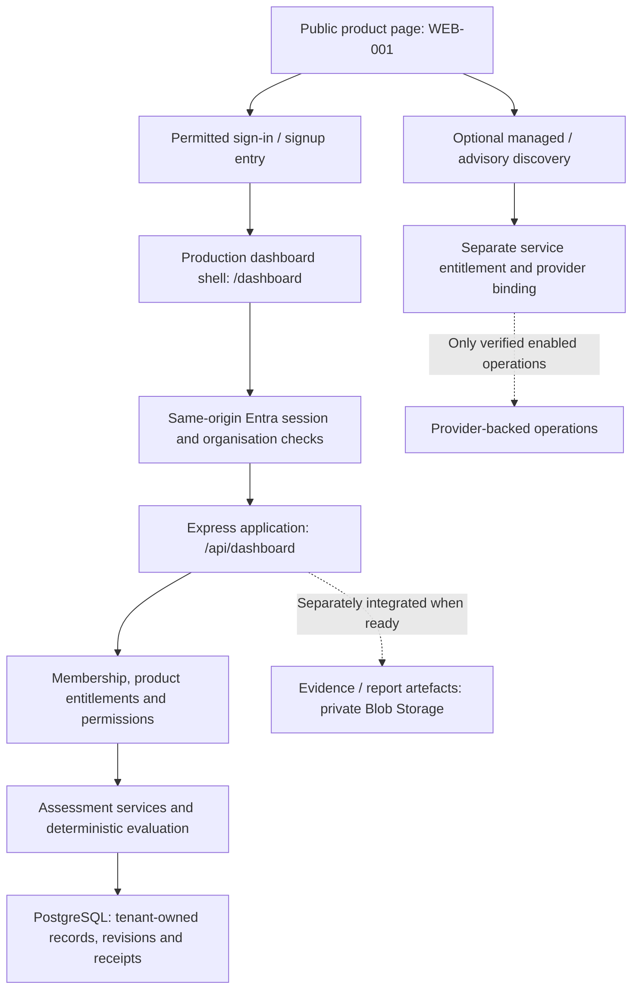

# Dashboard frontend and backend map

This is an integration map, not a status tracker or a claim that every capability
is deployed. Start at [#17](https://github.com/Discla1mer/NoFries/issues/17), then the
selected issue, existing ExecPlan and exact source/test/live evidence. The
[four-platform operating model](four-platform-operating-model.md) owns cross-system
responsibilities; [engineering continuation](engineering-workflow.md) covers handoffs.
Product decisions belong in GitHub, business relationships in HubSpot, acquisition
in Apollo and actual application operation/data in Azure.

## Three distinct experiences

**Public website — [#289](https://github.com/Discla1mer/NoFries/issues/289).**
`index.html`, `home.css` and `js/home.js` introduce the product and its permitted
entry points. Dashboard-first messaging is part of the same production product;
a full marketing redesign need not block a working first customer journey.
Keep managed-IT discovery/prospect chat separate from account membership. Do not
expose protected bundles or development fixtures as an anonymous dashboard demo.

**Signed-in dashboard — [#17](https://github.com/Discla1mer/NoFries/issues/17).**
The source route is `/dashboard`, using `lib/dashboardDocument.js` and
`app/dashboard.html`. `server.js` separately composes protected `/api/dashboard`
handlers when configured. An HTML shell does not establish a session, enable a
module or grant organisation access. Matty and Wayne are initial users of this
same production application; later users follow reusable onboarding.

**Managed-service and staff workspaces.** `/portal` is the separate managed-service
customer portal; `/scoping` is protected discovery/onboarding; `/operator` is staff
work and `/support` is service operations. Do not redirect dashboard-only customers
into provider-dependent onboarding. Preserve these journeys during public redesign.

The original [shell milestone](dashboard-shell.md) discusses `/portal`; read it as
component history, not the assembled route inventory. Verify `server.js`, document
builders and actual runtime composition. `/signup` is the intended entry owned by
#274; a plan or callback string is not proof of an enabled hosted endpoint.

## Architecture and trust boundaries

This is a logical product flow, not a live Azure inventory. Keep the same-origin
Node/Express modular monolith. Static Web Apps is the public/domain boundary and
App Service hosts the application. [#273](https://github.com/Discla1mer/NoFries/issues/273)
owns actual topology, selected storage, recovery and deployment verification.

Authenticate server-side, load current membership/entitlement/permission state and
recheck every protected resource/write. Requested organisation and CRM IDs do not
grant access. PostgreSQL is the intended tenant-owned operational store with forced
row-level security, revisions and receipts; verify selection per module. Browser
session Blob storage is distinct from the later evidence pipeline. Dashboard-only
membership must not require a provider ID. See [admission](dashboard-admission.md),
[permissions](dashboard-permissions.md), [entitlements](dashboard-entitlements.md)
and [persistence](dashboard-persistence.md).

## First production release: screen to contract to proof

The first useful release is account creation/sign-in, cyber assessment, durable
save/resume, reproducible results and feedback. All subsequent increments use the
same accounts and history. Each row names an owning outcome, not another tracker.

| User surface | Backend / data contract | Owning issue and acceptance |
| --- | --- | --- |
| Signup, terms, sign-in and another customer | Entra/browser-auth plus reviewed signup composition; immutable identity, organisation membership and recoverable terms journal | [#274](https://github.com/Discla1mer/NoFries/issues/274): real hosted flow, correct organisation, restart and revoked/foreign denial; adding another synthetic user/organisation without source edits. Reconcile #266–#270. |
| `/dashboard` loading, Overview and navigation | `api/shared/dashboardRuntimeHandlers.js`, `dashboardService.js`, `dashboardAdmission.js`; current browser-safe projection, not a reusable access grant | [#273](https://github.com/Discla1mer/NoFries/issues/273) and #274: session, organisation, first-use/error/unavailable states, no provider prerequisite; [shell tests](dashboard-shell.md) plus actual hosted acceptance. |
| Cyber assessment list, question flow and saved progress | [Questionnaire/client](ncsc-questionnaire.md) → `/api/dashboard/ncsc/assessments` through `api/shared/ncscAssessmentHandlers.js` and `ncscAssessmentService.js` → [repository](dashboard-persistence.md) | [#11](https://github.com/Discla1mer/NoFries/issues/11): create/save/leave/resume/submit one durable revision without lost or duplicate answers; desktop, 320/390px and keyboard. |
| Submit and reopen results | [API](ncsc-assessment-api.md), deterministic evaluator, original submission receipt and [reviewed production policy](ncsc-production-policy.md) | [#12](https://github.com/Discla1mer/NoFries/issues/12): exact-input reproducibility and readable domain/control detail; distinguish completion, attainment, evidence, risk and trend. No browser/AI replacement score. |
| Feedback and future releases | HubSpot relationship/commitment → sanitised linked GitHub work → verified Azure release; no new feedback database implied | [#284](https://github.com/Discla1mer/NoFries/issues/284): measured live operation, follow-up and account/history preservation across upgrades; #275 verifies enabled-surface readiness. |

The [HTTP contract](ncsc-assessment-api.md) specifies list/create/read/save/submit,
request envelopes, permissions, expected revisions and idempotency. Source route
composition is not live operation. Apply production runtime/recovery, terms,
organisation access and readiness before actual customer use. Manual assessment
and results remain functional with AI disabled. A third user is not a new beta.

## Continuous product modules: reuse, integrate and verify

Navigation labels do not establish live features. Deliver these on the SAME
production product using the existing engine and saved source, not another lifecycle.

| Surface | Frontend/backend connection and owning outcome |
| --- | --- |
| Improvement Plan | Action model/history → control/evidence links → list/board and completion/reopen, [#276](https://github.com/Discla1mer/NoFries/issues/276). |
| Evidence | Metadata/version history → private bytes and scoped links; quarantine, safe access and evidence semantics before uploads, [#277](https://github.com/Discla1mer/NoFries/issues/277); [persistence](evidence-persistence.md). |
| Board Reports | [Internal preview](board-report-preview.md) → retained snapshots → authorised UI/export, [#278](https://github.com/Discla1mer/NoFries/issues/278). A preview is not an issued report. |
| Advisory and Services | Scoped workflow [#279](https://github.com/Discla1mer/NoFries/issues/279); independent service entitlements/provider bindings. Paid activation [#280](https://github.com/Discla1mer/NoFries/issues/280) needs approved commercial terms, not an invented price. |
| AI Governance / IT Optimisation | Versioned profiles on the common assessment/results/actions/reporting engine, [#281](https://github.com/Discla1mer/NoFries/issues/281) and [#283](https://github.com/Discla1mer/NoFries/issues/283). |
| Question-level AI help | [Assistance contracts](questionnaire-assistance.md) → authorised provider, bounded ingestion, durable proposal/decision history, [#282](https://github.com/Discla1mer/NoFries/issues/282). Explicit confirmation; no AI-owned scoring. |

## Dependency sequence

**#276 Stage A (IMP-001 action model/service) → #277 (IMP-003 evidence/control/action
linkage, consuming the evidence metadata contract) → #276 Stage C (IMP-004
integrated plan interface).** Preserve original acceptance; do not add reciprocal
whole-issue blockers. Independent source/layout work may proceed before downstream
completion; joined acceptance still requires backend contracts and tests.
#289 may progress alongside #17, but public account-entry claims must match the
verified #273/#274/#275 journey.

## Evidence and maintenance

Distinguish implemented, tested, merged, deployed, verified live and customer
active. Keep exact checks, observations, source revisions, owner and next action
on the owning issue/PR, not as copied mutable statuses in this map. Screenshots,
anonymous 200/401 and the legacy-named Build and Deploy Job do not replace an
authenticated end-to-end test. Maintain this map when architecture, navigation
or responsibilities change; preserve original component evidence and decisions.
