# Stream G mobile evidence

Chromium at 375 CSS pixels, using fictional records on loopback. The before captures use main at `c4a070cd891ae3046c6221d008e31fecf17f25cc`. Both sides use the same viewport and finding-specific scenario.

| Finding | Observation | Before | After |
|---|---|---|---|
| D-048 | Actions used to lead with unrelated scheduled work. Its first list now uses the selected assessment’s existing top-three gap order and gives a concrete check for each. | 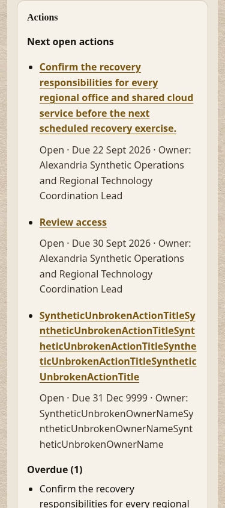 | 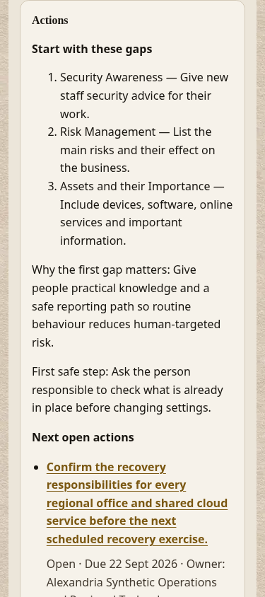 |
| D-003 | The separate gaps section already explained why each mattered. The Actions card now gives the reason for starting with the first gap and a safe first step. | 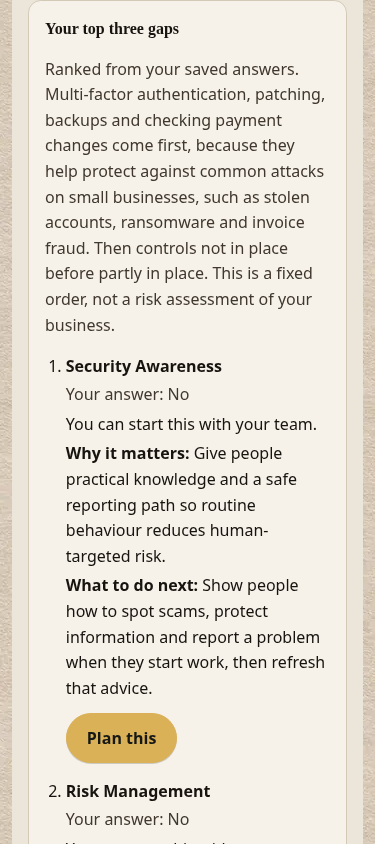 | 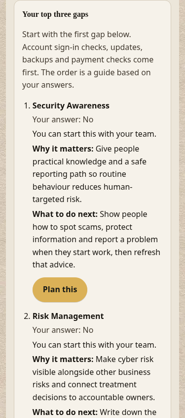 |
| A-019 | Three of fourteen answers are resolved. Main already put the range below the headline. The new headline asks for Unknowns to be confirmed and shows the eleven still to confirm. The existing 50% threshold is unchanged. | 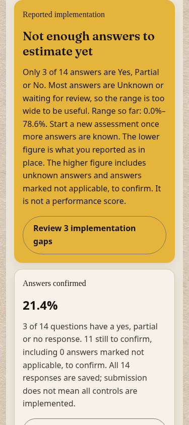 | 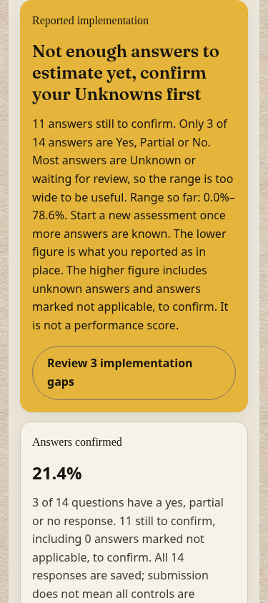 |
| D-004 | Already covered for structured declarations. Both captures show included and excluded items and explain how to correct the scope by starting a new assessment. Legacy free text is preserved as entered. | 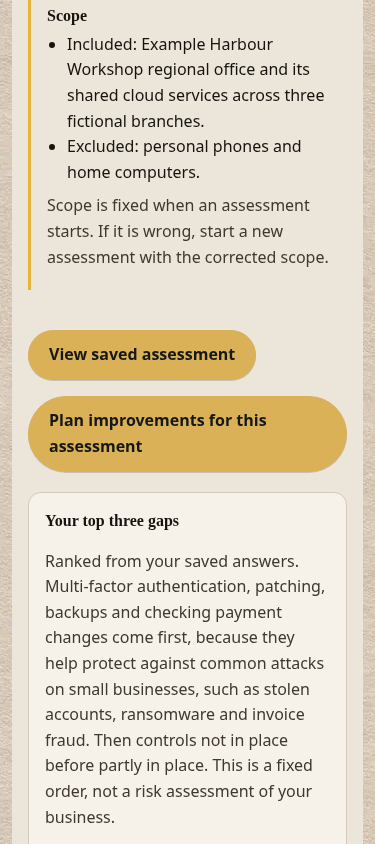 | 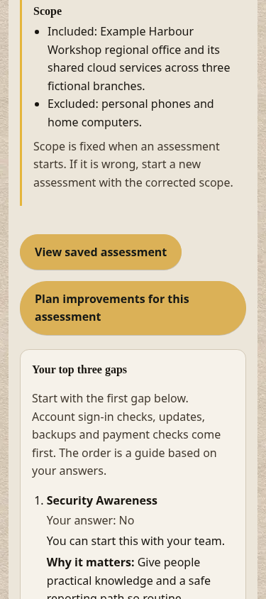 |
| D-017 | The selector previously shortened this fictional scope to 60 characters. Its option uses the available title and a wrapping caption shows the selected detail’s full text, status and NZ date. List summaries can be shortened by the API until selected. | 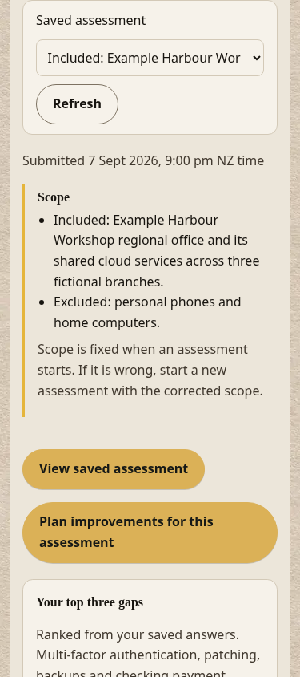 | 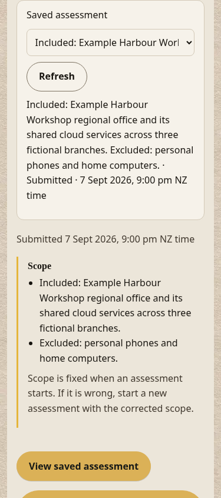 |
| D-027 | The footer already used NZ time and advanced after successful reads. The timestamp is now hidden because it could be mistaken for the age of the result. | 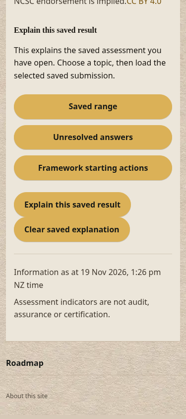 | 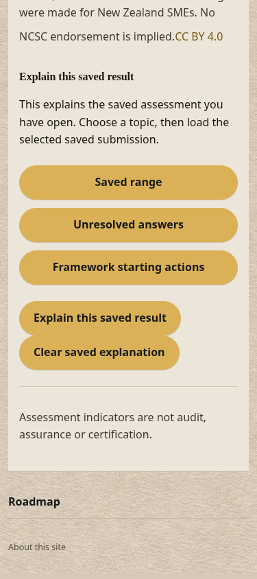 |
| D-043 | A completion note with a blank evidence reference already raised a field-level error and sent zero commands. The error now gives an example ticket ID. This records an unverified reference. | 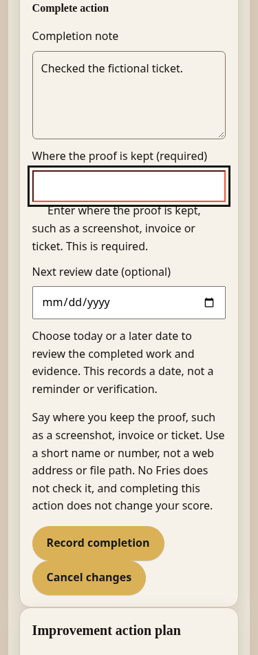 | 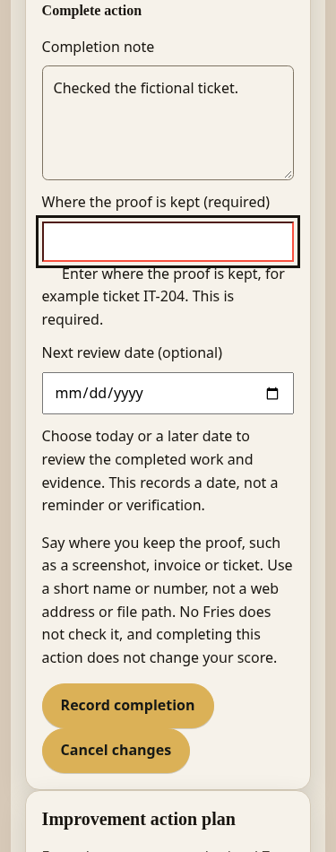 |
| D-044 | After an actual synthetic submission, the screen builds a preview from the saved answers. Its link carries the selected result into Improvement Plan. Saving a trackable plan still takes an explicit action. | 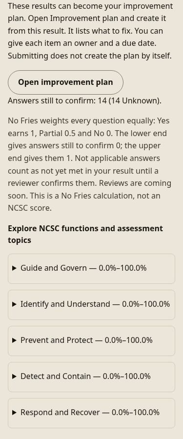 | 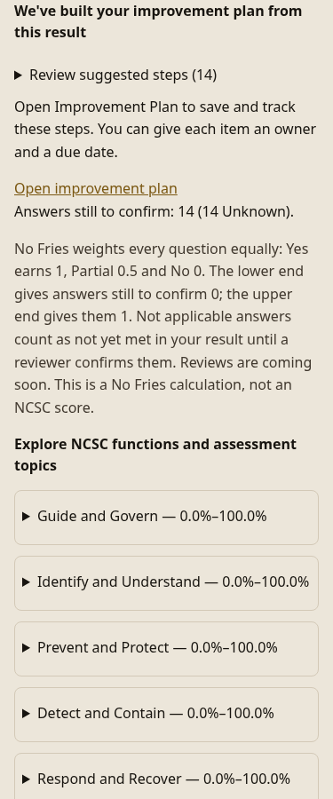 |
| D-049 | Opening the dashboard directly at #plan previously landed on Overview. It now opens Improvement Plan using the existing permission check and canonical #improvement-plan destination. | 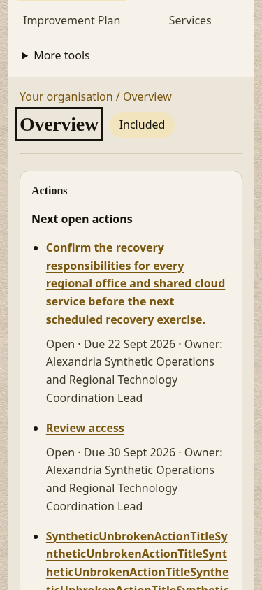 | 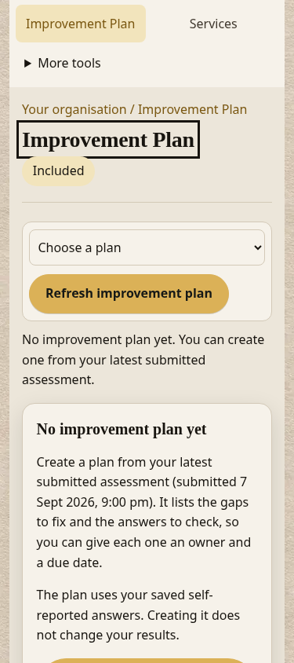 |
